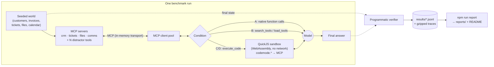

# CodeModeBench

**A reproducible benchmark of direct MCP tool calling versus Code Mode, where the model writes code against an MCP-derived TypeScript API.**


Agents usually use [Model Context Protocol](https://modelcontextprotocol.io) servers by exposing every tool to the model as a function call. In September 2025, Cloudflare proposed [**Code Mode**](https://blog.cloudflare.com/code-mode/) as an alternative. Code Mode converts the MCP tools into a TypeScript API and asks the model to write code that calls that API inside a sandbox. Anthropic described the same pattern in [*Code execution with MCP*](https://www.anthropic.com/engineering/code-execution-with-mcp). It reported that one example workflow dropped from about 150,000 to about 2,000 tokens.

Those claims are persuasive, but most of the public evidence so far comes from vendor write-ups and single workflows on large hosted models. Most of it measures tokens rather than correctness. CodeModeBench is an open harness for testing the idea under controlled conditions:

- **It verifies correctness against state.** Every task is checked programmatically against the final state of the simulated systems, or against the exact expected answer. No model acts as a judge.
- **It runs the same tasks under four interaction modes:** direct tool calling, tool search, Code Mode, and Code Mode with progressive API discovery.
- **It controls the variables.** These are the number of tools exposed (5 to 162), the length of the call chain, the size of the intermediate data, and the model.
- **It is reproducible on free hardware.** Deterministic MCP servers need no API keys. Local models run through [Ollama](https://ollama.com). Experiments are resumable, responses are cached, and every result row records the git commit, model digest and hardware.
- **It refuses to invent numbers.** The results section below is generated from raw run logs by `npm run report`. Results from the harness's scripted test backend are excluded automatically.

---

## Results

<!-- RESULTS:START -->
_No benchmark results have been published yet._

Results are generated exclusively from run logs in `results/` by `npm run report`. See [Reproducing the results](#reproducing-the-results) to produce them on your own hardware.
<!-- RESULTS:END -->

The hypotheses and analysis plan were committed before any model was run: see [`HYPOTHESES.md`](HYPOTHESES.md).

### Static context cost

How large is the first request in each condition, before the model has done anything? This is fully deterministic, and you can reproduce it with `npm run sizes`:

| Tools exposed | A · Direct tool calling | B · Tool search | C · Code Mode | D · Code Mode + discovery |
|---|---|---|---|---|
| 5 | 3,073 chars (~769 tok) | 1,596 chars (~399 tok) | 6,540 chars (~1,635 tok) | 2,300 chars (~575 tok) |
| 20 | 8,177 chars (~2,045 tok) | 1,596 chars (~399 tok) | 14,997 chars (~3,750 tok) | 2,300 chars (~575 tok) |
| 50 | 16,147 chars (~4,037 tok) | 1,596 chars (~399 tok) | 24,776 chars (~6,194 tok) | 2,300 chars (~575 tok) |
| 150 | 42,985 chars (~10,747 tok) | 1,596 chars (~399 tok) | 57,102 chars (~14,276 tok) | 2,300 chars (~575 tok) |

Code Mode's *up-front* cost is higher than direct calling, because the generated API includes return types derived from MCP output schemas. Any saving therefore has to come from what happens after the first request: intermediate results that stay inside the sandbox instead of passing through the model. Measuring that trade-off is the point of the benchmark.

---

## How it works



1. **World.** A deterministic generator creates a fictional B2B company with 120 customers, 424 invoices, 400 support tickets, a shared drive, a calendar and a staff directory. Each run gets a fresh copy.
2. **MCP servers.** Four servers, built with the official [MCP TypeScript SDK](https://github.com/modelcontextprotocol/typescript-sdk), expose 18 core tools with input and output schemas. Realistic distractor servers (HR, inventory, marketing, DevOps, finance, analytics) add up to 144 plausible but irrelevant tools for the tool-count sweep.
3. **Conditions.** The same task, servers, base system prompt and turn budget are used under each condition:

   | | Condition | What the model sees | Tools offered |
   |---|---|---|---|
   | A | **Direct tool calling** | Every MCP tool as a native function | all exposed tools |
   | B | **Tool search** | Meta-tools to search and load tools on demand | `search_tools`, `load_tools` (+ loaded tools) |
   | C | **Code Mode** | The generated TypeScript API in the system prompt | `execute_code` |
   | D | **Code Mode + discovery** | No API up front; declarations loaded on demand | `list_apis`, `read_api`, `execute_code` |

   Condition B controls for "fewer tool definitions in context" without code execution. Condition D controls for "a large API in the prompt". Together they help separate *why* Code Mode helps, if it does.

4. **Sandbox.** In Code Mode, model-written TypeScript is transpiled with esbuild and executed in [QuickJS compiled to WebAssembly](https://github.com/justjake/quickjs-emscripten). The guest has no `fetch`, `require`, `process`, timers or module loader. Its only capability is the `codemode` object, whose methods are bridged to MCP calls by the host, as with Cloudflare's bindings. Memory, CPU time and host-call limits are enforced.
5. **Verification.** Each task has a programmatic verifier. A verifier either compares the final answer with values computed from the world, using closed vocabularies and ID sets, or diffs the final world state against the initial one. Verifiers also reject collateral changes to records the task did not ask to touch.

---

## Task suite

40 tasks in 5 categories (the full list is in [`docs/TASKS.md`](docs/TASKS.md)):

| Category | Tasks | Example |
|---|---|---|
| Lookup | 8 | *Who is the account manager for the customer who opened ticket T0200?* |
| Aggregate | 12 | *How many support tickets tagged "billing" belong to customers who have at least one overdue invoice?* |
| Transform | 5 | *Read /exports/vip_list.csv. Which of those customers currently have an urgent or high-priority ticket that is not closed?* |
| Write | 12 | *Apply the escalation policy in /policies/escalation.md to all tickets.* |
| Privacy-sensitive | 3 | *Send a payment reminder email to every customer that has at least one overdue invoice…* |

Tasks are tagged by **chain length** (single, short, long, loop) and **payload size** (small or large intermediate data). A 15-task **pilot subset** spans all categories. Every task is proven solvable under every condition by a reference solution that runs through the full harness in CI.

---

## Quickstart

Requirements: Node.js ≥ 20. For real model runs you also need [Ollama](https://ollama.com/download), or an OpenAI-compatible endpoint.

```bash
npm ci
npm test                 # 257 tests: sandbox isolation, codegen, servers, verifiers, providers, runner
npm run bench:ci         # every task × every condition via reference solutions (no model, ~15 s)
npm run tasks            # list the task suite
npm run sizes            # static context cost per condition
```

## Reproducing the results

The pilot is sized for a consumer laptop. It was configured on a 4 GB VRAM GPU with 8 GB of system RAM.

```bash
# 1. Pull the models (free, local)
ollama pull qwen3:1.7b
ollama pull qwen3:4b

# 2. Run the pilot: 240 runs, resumable (Ctrl-C and re-run at any time)
npm run bench -- --config configs/pilot.yaml

# 3. Aggregate into reports/index.html, reports/summary.json and the README results section
npm run report
```

Useful options:

- `--limit 10` runs only the next 10 pending runs.
- `--models qwen3-4b` restricts the run to one model.
- `--shard 2/4` splits the grid across machines or sessions.
- `--dry-run` shows what would run.

If memory is tight, set `OLLAMA_FLASH_ATTENTION=1` and `OLLAMA_KV_CACHE_TYPE=q8_0` before starting Ollama. You can also lower `contextWindow` in the config, which the results record.

For larger models (Qwen3 8B/14B), [`kaggle/run_sweep.ipynb`](kaggle/run_sweep.ipynb) runs [`configs/full.yaml`](configs/full.yaml) on a free Kaggle GPU using the same CLI.

### Other providers

Any OpenAI-compatible endpoint works. Presets exist for Groq, Gemini and OpenRouter (see [`configs/cloud-free.yaml`](configs/cloud-free.yaml) and [`docs/ADDING_A_MODEL.md`](docs/ADDING_A_MODEL.md)):

```yaml
models:
  - { id: my-vllm-model, provider: openai-compatible, baseUrl: "http://localhost:8000/v1", model: "Qwen/Qwen3-8B", temperature: 0.7 }
```

### Inspect your own MCP server

The harness can connect to any stdio MCP server. It reports how large its tool schemas are in direct mode compared with the TypeScript API Code Mode would generate:

```bash
npm run inspect -- --server "npx -y @modelcontextprotocol/server-filesystem ." --dts filesystem.d.ts
```

---

## Methodology at a glance

- **Same everything except the interaction mode.** The base system prompt, task prompt, servers, data, turn budget (20), run time limit (900 s), sampling settings and tool-result cap (100k characters, applied to tool results and sandbox output alike) are shared across conditions.
- **No silent truncation.** A conversation that outgrows the model's context window is recorded as a `context_overflow` failure instead of being truncated without notice.
- **Realistic APIs.** List endpoints are paginated (`limit`/`offset` with a `total`), return verbose records, and validate their inputs. Errors come back to the model, as they would from a real MCP server.
- **Lenient parsing, recorded.** Small models sometimes write a tool call or code block as plain text. With `lenientParsing: true` (the default), the harness recovers these in every condition and counts each recovery, so strict and lenient behaviour can both be analysed.
- **Statistics.** Success rates come with Wilson 95% intervals. Conditions are compared on matched task × seed pairs with an exact McNemar test.
- **Provenance.** Each result row includes the task-set fingerprint, git commit (with a dirty flag), model digest and quantisation, sampling parameters and hardware. Rows from different task-set fingerprints are never mixed in a report.

The details are in [`docs/METHODOLOGY.md`](docs/METHODOLOGY.md), and the known threats to validity are in [`docs/LIMITATIONS.md`](docs/LIMITATIONS.md).

## Project layout

```
src/
  world/        deterministic data generator
  servers/      MCP servers (crm, tickets, files, comms) + distractor tools
  mcp/          MCP client pool (in-memory and stdio transports)
  codemode/     JSON Schema → TypeScript codegen, esbuild transpile, QuickJS sandbox
  conditions/   A direct · B tool search · C Code Mode · D Code Mode + discovery
  llm/          Ollama and OpenAI-compatible backends, response cache, rate limiting
  agent/        the shared agent loop and per-run metrics
  tasks/        task suite, verifiers, reference solutions
  bench/        experiment configs, metadata capture, resumable runner
  report/       statistics, HTML dashboard, README results block
configs/        experiment grids (ci, pilot, full, cloud-free)
results/        raw per-run records (runs.jsonl) and gzipped traces
reports/        generated dashboard and summary
tests/          vitest suite
```

## Citation

If you use this benchmark, please cite it with the metadata in [`CITATION.cff`](CITATION.cff).

## References

- K. Varda, S. Pai. [*Code Mode: the better way to use MCP*](https://blog.cloudflare.com/code-mode/). Cloudflare, 26 September 2025.
- Anthropic. [*Code execution with MCP: Building more efficient agents*](https://www.anthropic.com/engineering/code-execution-with-mcp). 4 November 2025.
- X. Wang et al. [*Executable Code Actions Elicit Better LLM Agents*](https://arxiv.org/abs/2402.01030) (CodeAct). ICML 2024.
- [Model Context Protocol specification](https://modelcontextprotocol.io).

## License

[MIT](LICENSE)
